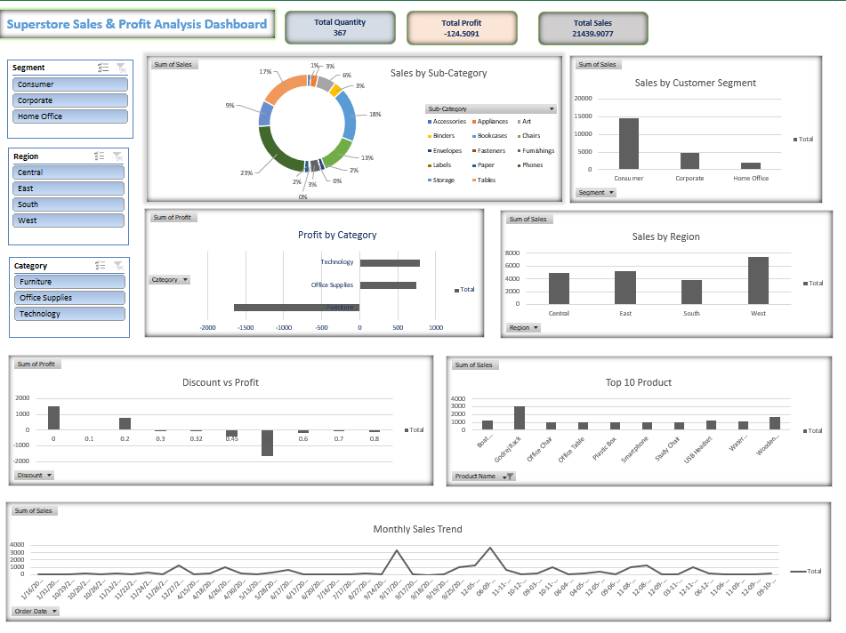

# 📊 Superstore Business Intelligence Dashboard

An interactive Business Intelligence Dashboard developed using **Microsoft Excel** to analyze Superstore sales performance, profitability, product categories, customer segments, and regional business trends.

## 📌 Project Overview

This project focuses on transforming raw Superstore sales data into meaningful business insights using Excel. The dashboard provides a clear overview of key business metrics and enables users to explore sales performance through interactive slicers and visualizations.

The main objective is to support data-driven decision-making by identifying sales trends, profitable categories, regional performance, and business opportunities.

## 🎯 Project Objectives

* Analyze overall sales and profit performance.
* Identify top-performing product categories and regions.
* Understand customer purchasing patterns.
* Track monthly sales trends.
* Evaluate business performance using KPIs.
* Create an interactive dashboard for better decision-making.

## 🛠️ Tools & Technologies

* **Microsoft Excel**
* Pivot Tables
* Pivot Charts
* Excel Formulas
* Slicers
* Data Cleaning
* Data Visualization
* KPI Analysis

## 📊 Key Performance Indicators (KPIs)

The dashboard includes the following key metrics:

* Total Sales
* Total Profit
* Total Quantity Sold
* Total Orders
* Average Sales
* Average Profit
* Unique Customers
* Total Discount

## 📈 Dashboard Features

* Interactive dashboard with dynamic slicers.
* Sales and profit performance analysis.
* Category-wise sales comparison.
* Region-wise business performance.
* Customer segment analysis.
* Monthly sales trend visualization.
* KPI cards for quick business insights.
* User-friendly dashboard layout.

## 🖼️ Dashboard Preview



## 📂 Project Structure

```text
Superstore-Business-Intelligence-Dashboard/
│
├── Superstore_Dashboard.xlsx
├── Dashboard_Screenshot.png
└── README.md
```

## 🔍 Key Insights

* Analyzed overall sales and profitability.
* Identified performance differences across regions.
* Compared sales across product categories.
* Evaluated customer segment contributions.
* Explored monthly sales trends.
* Identified areas requiring improvement in profitability.

## 💡 Skills Demonstrated

* Data Cleaning and Preparation
* Exploratory Data Analysis (EDA)
* Excel Data Analysis
* Pivot Table Analysis
* Data Visualization
* Dashboard Development
* Business Intelligence
* Analytical Thinking

## 🚀 How to Use

1. Download the Excel file from this repository.
2. Open it using Microsoft Excel.
3. Navigate to the Dashboard sheet.
4. Use the interactive slicers to filter the data.
5. Explore the visualizations and business insights.

## 👨‍💻 Author

**Sanket Vijay Sahane**

Artificial Intelligence & Data Science

GitHub: [@sanketsahane56](https://github.com/sanketsahane56)

Portfolio: [Visit My Portfolio](https://sanketsahane56.github.io/Sanket-Portfolio/)

---

⭐ If you find this project useful, consider giving it a star!
